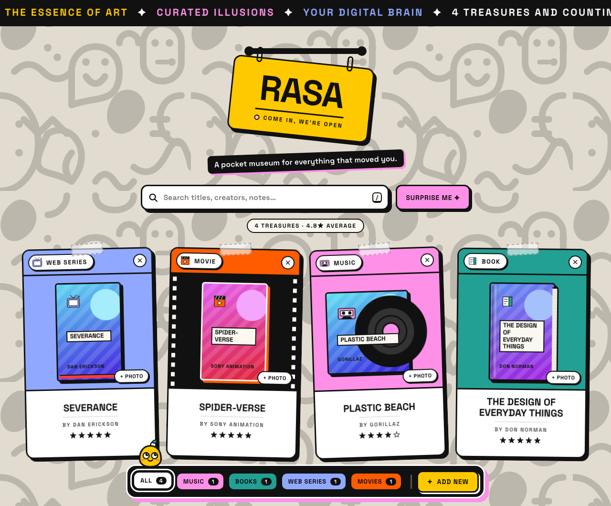

# Rasa

A pocket museum for the music, books, web series and movies that moved you. Rasa is a single HTML file with no build step. It needs no account: sign in with Google only if you want the same shelf on all your devices.

**Live demo:** [kuldeep-shr.github.io/rasa-vault](https://kuldeep-shr.github.io/rasa-vault/)



## Features

- **Four shelves.** Music, Books, Web Series and Movies, each with its own colour and doodle wallpaper.
- **Flip cards.** The back of a card holds your note and a five-star rating you can tap.
- **Covers that keep their shape.** Album sleeves get a vinyl record, posters sit on a film strip, and books get a spine and pages. Nothing is cropped.
- **One card per thing.** Start typing something that's already on your shelf and Rasa points to the card you have. Saving opens that card instead of making a second one. Titles match whatever the case, accents or punctuation, with or without a leading "The", "A" or "An". The same title by a different creator is a different thing, so two songs called "Hurt" can both stay.
- **Photos your way.** Upload, paste or drop an image onto a card, or let Rasa look one up when you save. Anything without a photo gets a poster made from its title.
- **A quick tour.** The first time someone opens Rasa, a short tour lights up each part in turn: adding something, flipping a card, the shelves, search, sharing, your rasa and the curator card. Each step is a line or two of plain words with Back and Next, and ✕ closes it at any step. It never opens by itself again, and **Take a tour ✦** under the sign or the `?` key brings it back.
- **Rasu.** A small pet on the dock that follows your cursor, reacts to what you do and naps when you go quiet.
- **Share my shelf.** Turns the shelf you're looking at into a picture sized for Stories, with your six highest-rated cards and their covers, ready to share or save. It's drawn on your device.
- **What's your rasa?** In Indian art, *rasa* is the feeling a work leaves in you, and there are nine: love, laughter, sorrow, fury, courage, fear, disgust, wonder and peace. Tag each card with the one it left you with, in the card form or all at once under **My rasa ✦**. If a second feeling stayed behind (it made you laugh, then left you tender), the card form also takes an optional **aftertaste**: one more rasa, different from the first, shown under it on the back of the card. Once three cards are tagged, Rasa reads your rasa, the one most of their main rasas share, and draws it as a picture for Stories. The picture has a nine-petal lotus in the Natya Shastra's colours and three of the cards behind your rasa. Searching a rasa's name, like "karuna" or "wonder", finds the cards tagged with it, as their rasa or their aftertaste.
- **Your curator card.** A name and a username for your museum, under the sign. Rasa makes up a username for you, like `@velvet.vinyl` or `@moonlit.matinee`, and you can change both any time. Your shared pictures are signed with them.
- **Sync across devices (optional).** Sign in with Google from your curator card and every device you use shows the same shelf: cards, ratings, notes, rasas, photos and your curator card. Changes arrive within seconds, deleting a card deletes it everywhere, and two devices that each added the same thing end up with one card.
- **Feedback switches.** No form and nothing to type. Visitors switch on what feels true, like *I love Rasa* or *Make a phone app*, and send it to Rasu. Each knob is a sleepy face that wakes up and smiles when it's on. Beside them, two counters show how many curators Rasa has so far and how many have sent feedback.
- **Search, Surprise me and Undo,** plus keyboard shortcuts: `/` to search, `N` to add, `R` for a surprise pick, `S` to share, `?` for the tour.
- Works on phones, supports the keyboard and respects reduced-motion settings.

## Run it

Open `index.html` in a browser.

For live reload while you edit:

```bash
npx live-server --port=5500
```

## Deploy

Rasa is one static file, so any static host works:

- **GitHub Pages:** Settings → Pages → Deploy from a branch → `main`, root folder.
- **Netlify or Cloudflare Pages:** upload the folder.

On a new host, sign-in for sync only works once that domain is added to the Firebase project's authorized domains (see [Sync across devices](#sync-across-devices)).

## Where data is stored

Without signing in, everything stays in the visitor's browser: items, name, username, feedback answers and whether the tour has been seen in `localStorage`, and photos in IndexedDB. Each visitor has their own vault, and clearing site data clears it.

Every tab and window of the same browser shares that vault. A change made in one shows in the others straight away, and each change starts from the latest saved copy, so an older tab never writes over a newer one. Another browser or device has a vault of its own, unless you sync.

## Sync across devices

Sync is switched on by the Firebase web config in `SYNC` in `index.html`, and it's on in the live demo. With an empty `apiKey` there's no sync button and nothing changes.

With the config in, sync is still off for each visitor until they press **Sign in with Google** on their curator card, or **Sync devices ☁** under the sign. Until then, the page loads nothing from Google.

Once signed in, the shelf is also kept in Cloud Firestore (in Mumbai, `asia-south1`) under that Google account, and every device signed in to the same account shows the same shelf. A device signed in to a different Google account has a shelf of its own, so the sync box shows which account each device uses. The browser keeps its own copy too, so Rasa still works offline and catches up when it's back. Signing out keeps the shelf on that device and stops syncing it.

Google doesn't allow signing in inside an app's own browser, such as the one LinkedIn or Instagram opens links in. There, the sync box offers to copy the link instead, so it can be opened in Safari or Chrome.

| What | Where in Firestore |
| --- | --- |
| Cards | `shelves/{uid}/items/{id}`: shelf, title, creator, rating, note, when it was added and when it last changed |
| Photos | `shelves/{uid}/photos/{id}`: the JPEG, made smaller when needed to fit Firestore's 1 MB limit |
| Curator card | `shelves/{uid}`: name and username |

How devices agree:

- **The newest change wins, card by card.** A rating changed on one device and a note changed on another both survive, and every tab and device stays in step without writing back and forth.
- **A device that was offline doesn't overwrite newer changes.** It waits for the cloud's copy before sending anything, then sends only what's newer on that device.
- **Deleting a card deletes it everywhere.** A deleted card leaves a small note of when it went, so a device that still has the old copy doesn't bring it back. Undo brings it back everywhere.
- **One card per thing, across devices too.** If two devices each added the same thing before they synced, the two cards become one: the one with a photo, otherwise the older one. It also takes the other's creator, rating and note when it has none, and keeps both notes if they differ.
- **Example cards** that nobody has touched never override a real change, and an example card removed on any device is removed everywhere.

Only the signed-in account can read or write its shelf. These are the Firestore security rules:

```text
rules_version = '2';
service cloud.firestore {
  match /databases/{database}/documents {
    match /shelves/{uid}/{document=**} {
      allow read, write: if request.auth != null && request.auth.uid == uid;
    }
  }
}
```

The Firebase settings in `SYNC` in `index.html` (API key, project ID and so on) are meant to be public. They only identify the project, and the rules above keep each shelf private.

A fork should use its own Firebase project, on the free Spark plan:

1. Create a project in the [Firebase console](https://console.firebase.google.com).
2. Turn on **Authentication → Sign-in method → Google**, and add your site under **Authentication → Settings → Authorized domains**.
3. Create a **Firestore** database in production mode and publish the rules above.
4. Register a web app and copy its config into `SYNC`.

Leave `apiKey` empty to turn sync off.

## Visit counts

Rasa counts a few things with [GoatCounter](https://www.goatcounter.com), so the site owner can see how it's doing:

| Count | When |
| --- | --- |
| A visit | The page opens. Also records where the visitor came from and their screen size. |
| `joined` | A browser opens Rasa for the first time. |
| `added-movie`, `added-book`, `added-music`, `added-series` | Someone saves a new item. Only the shelf is sent. |
| `shared-shelf`, `saved-shelf` | Someone shares or saves a picture of their shelf. |
| `rasa-read`, `shared-rasa`, `saved-rasa` | Someone reads their rasa, then shares or saves its picture. Which rasa it is isn't sent. |
| `sync-on` | Someone signs in with Google to sync their shelf. |
| `feedback-sent`, plus `feedback-love`, `feedback-easy`, `feedback-friend`, `feedback-app`, `feedback-shelves` | Someone presses **Send to Rasu**. One `feedback-sent`, and one count for each switch they turned on. Sending the same answers again from the same browser isn't counted. |

Only these plain numbers are sent. There are no cookies, and a title, note, name or username is never sent. Browsers that send Do Not Track or Global Privacy Control aren't counted, except for feedback, which is only sent when someone presses Send.

To see which platform brings visitors, tag your links, for example `https://kuldeep-shr.github.io/rasa-vault/?ref=instagram`. GoatCounter lists each tag as a campaign.

Counting is off while `STATS.code` in `index.html` is empty, and it only runs on `STATS.host`. A fork counts nothing until you put in your own GoatCounter code and host.

To keep your own visits out of the numbers, open `https://kuldeep-shr.github.io/rasa-vault/#me` once in each browser you use, including the in-app browsers of Instagram, LinkedIn and the like, which keep their own storage. That browser then sends nothing at all, whichever link or network brought it, and Rasu confirms with "I won't count this browser ✓". Open `#me-off` to be counted again. It's only a flag in that browser's local storage, so clearing the site's data or using a private window brings counting back.

### Counters on the page

The feedback section shows two numbers, read from GoatCounter's public visitor counter when the section scrolls near:

| Counter | Read from |
| --- | --- |
| Curators so far | `joined` |
| Sent feedback | `feedback-sent` |

GoatCounter counts each as visitors, so they count browsers rather than people. They're cached for up to four hours, so the visitor's own first visit and first feedback are added on top. Reading them counts nothing.

They only appear once the GoatCounter setting **Allow adding visitor counts on your website** is on. Until then the counter answers 403 and the section shows no numbers. Turning it on lets anyone read the count for any page or event on the site, not just these two.

## Photo lookup

When you save a new item without a photo, or press **Find photo** on the back of a card, Rasa searches once for cover art. It never searches while you type.

| Shelf | Sources, in order |
| --- | --- |
| Web Series | TVmaze, then the iTunes Search API |
| Music, Movies | iTunes Search API |
| Books | iTunes Search API, then Open Library |

Apple's search starts in your country's store and falls back to the US store. A result is used only when its name matches the title you typed, so a store that doesn't carry a title can't give you another one's cover. If nothing matches, Rasa makes a poster from the title.

Only the title and creator are sent, and only on that press. No API keys are needed. Images are resized to 1200px and stored in the browser. To turn lookups off, set `AUTO_PHOTOS = false` in `index.html`.

## Contributing

Issues and pull requests are welcome. The whole app lives in `index.html`: styles at the top, markup in the middle and the script at the bottom. Please keep it free of build tools. The only outside code is the Firebase SDK, which loads from Google's CDN when someone signs in to sync.

## Credits

Cover lookups use the [iTunes Search API](https://performance-partners.apple.com/search-api), [TVmaze](https://www.tvmaze.com/api) (data licensed CC BY-SA) and [Open Library](https://openlibrary.org/developers/api). Sync uses [Firebase](https://firebase.google.com) Authentication and Cloud Firestore. The typeface is [Space Grotesk](https://fonts.google.com/specimen/Space+Grotesk).

## License

[MIT](LICENSE) © 2026 Kuldeep Sharma
